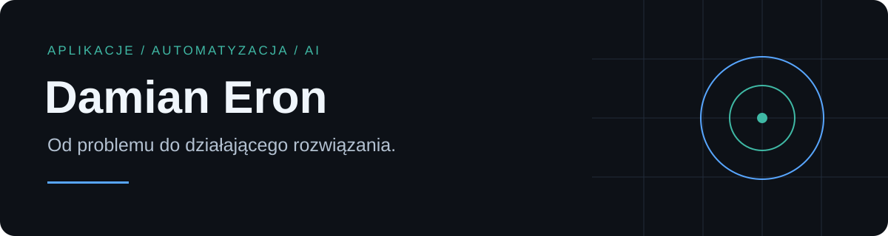

Tworzę aplikacje i automatyzacje, które rozwiązują konkretne problemy. Łączę doświadczenie w obsłudze IT z rozwojem oprogramowania, integracjami AI i elektroniką. Interesuje mnie cały proces: od zrozumienia potrzeby, przez działający produkt, po jego utrzymanie.

## Wybrane projekty

| Projekt | Co tworzę | Prezentacja |
| :--- | :--- | :--- |
| **JARVIS** | Osobisty asystent AI porządkujący wiedzę, kontekst i zadania oraz wspierający pracę nad projektami. | [Karta projektu →](projects/jarvis.md) |
| **eDziennik** | Aplikacja webowa wspierająca organizację szkoły językowej. | [Karta projektu →](projects/edziennik.md) |
| **OpenTicket** | System obsługi zgłoszeń dla serwisów elektroniki. | [Repozytorium i kod →](https://github.com/damianx9x/OpenTicket) |
| **Ekspertyka** | Portal narzędziowy: GeoWyceny, dokumenty i raporty. | [Karta projektu →](projects/ekspertyka.md) · [Strona ↗](https://ekspertyka.pl/) |

Karty projektów pokazują zastosowanie i zakres mojej pracy. Nie zawierają kodu źródłowego, konfiguracji ani danych użytkowników.

## Publiczne repozytoria

- **[OpenTicket](https://github.com/damianx9x/OpenTicket)** — aplikacja webowa i desktopowa do obsługi zgłoszeń serwisowych.

- **[LGOFFB](https://github.com/damianx9x/LGOFFB)** — generator skryptu offboardingu Google Workspace z instrukcją i trybem DRY RUN.
- **[Lampa Portal S3](https://github.com/damianx9x/lampkav2)** — projekt lampy LED z ESP32, interfejsem webowym i animacjami.

## Obszary pracy

**Aplikacje webowe i desktopowe** · **Automatyzacja IT** · **Integracje AI** · **Elektronika i druk 3D**

Pracuję iteracyjnie: rozpoznanie problemu → mały działający rezultat → testy → poprawki. W opisach oddzielam dostępne funkcje od planów rozwoju.

---

Chcesz zobaczyć mój sposób pracy? Zacznij od kart projektów lub dokumentacji publicznych repozytoriów.
